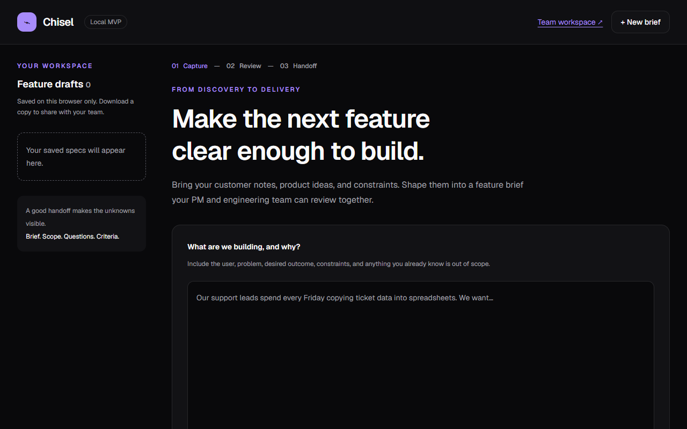

# Chisel

[](https://github.com/Atharvabagul84/Chisel/actions/workflows/ci.yml)
[](LICENSE)


**A spec-review app whose security lives in the database, not the UI.**

Chisel turns a rough feature brief into an editable spec (problem, scope, user stories, acceptance criteria, open questions, risks) that a PM and engineers review together. An LLM writes the first draft; people edit and hand it off. Underneath, every authorization and abuse-control decision is enforced server-side and tested:

- **Row-level security on all 5 tables.** Clients get read-only policies; there are no direct table writes. Every write goes through a validated RPC whose implementation sits in a private, unexposed schema (`security definer`, empty `search_path`, `revoke all` from `public`/`anon`/`authenticated`). Role checks never trust client fields or JWT metadata.
- **17 SQL policy tests on a real PostgreSQL engine** (PGlite), plus a CI job that applies every migration to PostgreSQL 17 and fails if any public table lacks RLS.
- **Bounded, validated LLM boundary.** A streamed 64 KB request-body cap, content-type check and Zod schema on the way in; a 45-second deadline, a clean-finish check and a Zod schema on the model's output. Bad output is a visible error, never a fake sample.
- **Fail-closed abuse controls.** The hosted demo is rate limited per visitor (salted IP hash) and globally; if the limiter can't be reached, generation stops instead of running unlimited. Paid Anthropic generation is never opened to anonymous visitors.
- **Operable.** One JSON log line per API request with a request ID, status, latency and, for generation, prompt version, tokens and estimated cost. A small eval set checks spec properties.



**Hosted preview:** [chisel-chi.vercel.app](https://chisel-chi.vercel.app). AI drafts there run as a limited demo on Groq's free tier (3 per visitor per day, 100 per day in total); locally you can use your own Anthropic key.

**Development history:** built in a private repository from September to October 2026 (19 commits); public history starts at v1.0.0 (see the [changelog](CHANGELOG.md)). Access to the earlier history is available on request.

## What it does

- **Draft:** send a 30–12,000 character brief to the LLM, open a labelled worked example, or write manually. A failed generation shows a real error, never a fake success.
- **Review:** edit every section; mark acceptance criteria as personally reviewed (marks reset on edit and are never shown as test results or approvals).
- **Hand off:** export Markdown (requires complete fields; open questions stay visible) or JSON (backs up unfinished work).
- **Collaborate (optional):** Supabase verified-email sign-in, owner-managed workspaces, email-bound PM/engineer invitations, and shared briefs with immutable saved versions and stale-revision rejection.

## Engineering highlights

- **Authorization in the database:** no service-role key in the app; `getUser()` verifies every protected request; cookie mutations and hosted generation check the configured origin. See [ADR 0002](docs/decisions/0002-rls-authorization.md).
- **Tested SQL, not just UI:** policy and transaction tests on PGlite, plus provider failures (Anthropic and Groq), fail-closed limits, timeouts, draft preservation, revision conflicts and export fidelity. `npm test` runs them all.
- **LLM ops:** versioned system prompt (`promptVersion` in every response and log line), per-request token and cost accounting, and an [eval set](evals/README.md) of briefs with expected spec properties.
- **Provider adapters:** the controller, generation service and Anthropic/Groq adapters are separate modules behind one `CompleteFeatureSpec` type (`lib/server/`).

## Run locally

Node.js 22 or 24.

```bash
npm ci
cp .env.example .env.local        # add ANTHROPIC_API_KEY only if you want live generation
npm run dev -- --hostname 127.0.0.1 --port 3100   # http://127.0.0.1:3100
npm test && npm run lint && npm run typecheck && npm run build
```

Generation sends your brief to Anthropic and may incur charges on your key. Keep the dev server on loopback: the local generation endpoint has no per-user spending controls. Team workspaces need a Supabase project; see the [Supabase setup guide](docs/guides/supabase-setup.md).

## Architecture

- `app/page.tsx` → `components/FeatureWorkspace.tsx`: editing, cancellation, local drafts, exports.
- `lib/feature-spec.ts`: shared Zod generation contract. `lib/local-drafts.ts`: incomplete-draft validation and Markdown rendering.
- `app/api/generate-prd/` → `lib/server/`: controller, generation service, Anthropic and Groq adapters, hosted-demo rate limiter, request logging.
- `app/team/`, `lib/team/`, `supabase/migrations/`: workspaces, members, invitations, briefs and immutable versions behind RLS and RPCs.

Full detail: [architecture](docs/ARCHITECTURE.md) and the [decision records](docs/decisions/).

## Status and limits

A pilot-stage MVP. Formal PM/engineering approvals, a version-history UI, per-requirement source citations, audio transcription, billing and issue-tracker integrations are not built yet. Two-account collaboration checks are partly verified. Live model output quality hasn't been measured yet: tests use controlled provider responses, and schema validation checks structure, not truth. Details: [project status](docs/reference/status.md) · [project notes](docs/reference/project-notes.md).

## Documentation, contributing and security

Start at the [documentation index](docs/README.md). See [CONTRIBUTING.md](CONTRIBUTING.md) for setup, checks and the pull-request flow, [SECURITY.md](SECURITY.md) to report a vulnerability, and the [changelog](CHANGELOG.md).

## License

[MIT](LICENSE) © 2026 Atharva Bagul
